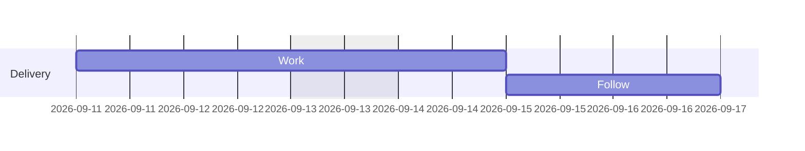
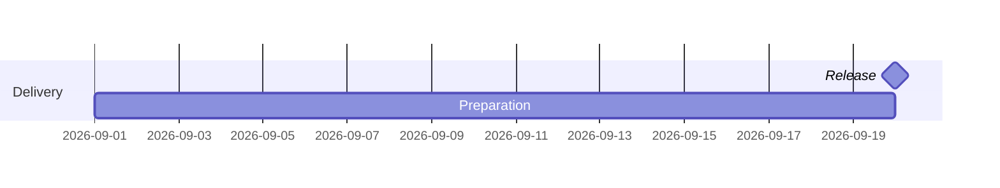

# Mermaid 甘特图样式工具 v2：官方引擎版

**输入 Mermaid gantt，输出同类泳道样式的 SVG / PNG。比例自由，排期由官方 Mermaid 计算。**

v2 不再使用 v1 的手写任务解析器或日期计算器。`excludes`、`includes`、`weekend`、`until`、`after`、隐式开始时间、自定义 `dateFormat`、小时/分钟/秒/毫秒工期、月/年工期、小数工期、`inclusiveEndDates`、`vert` 等直接交给官方引擎。

## 安装与运行

需要 Node.js 20+，以及可用的中文字体。

```sh
npm ci
npx playwright install chromium
node gantt.mjs examples/ws53.mmd -o result --width 2560
```

生成 `result.svg` 和 `result.png`。只生成一种格式：

```sh
node gantt.mjs examples/ws53.mmd -o result.svg
node gantt.mjs examples/ws53.mmd -o result.png
```

v2 的 **SVG 也需要浏览器**，因为官方 Mermaid 使用浏览器测量文本并绘制图形。安装依赖和浏览器后，渲染过程不访问 CDN。Linux 如缺少系统库，可按 Playwright 提示安装依赖。中文字体使用本机苹方、微软雅黑或 Noto Sans CJK SC / 思源黑体，文件不嵌入字体。

使用本机已有 Chrome，可不下载 Chromium：

```sh
npm ci
node gantt.mjs examples/calendar.mmd -o result \
  --browser '/Applications/Google Chrome.app/Contents/MacOS/Google Chrome'
```

## 两种输出模式

### styled：默认汇报风格

```sh
node gantt.mjs examples/ws53.mmd -o result \
  --width 2560 --aspect 16:9 --font-size 23 --row-height 27 \
  --release 2026-10-15 --today 2026-09-10 \
  --note '推动 WS53 裸片上架云汉芯城，时间待定'
```

- 原生任务进度条的位置、长度、旋转及泳道顺序保留。
- 灰色完成、蓝色计划、红色风险，白/浅蓝隔行底色。
- 泳道之间采用较粗的横向分隔线；左侧名称区域有连续底色块和边框，区别于逐行底色。分隔范围根据官方实际任务行计算，也兼容 compact。
- 普通布局的任务名称放在条形/里程碑右侧，就近显示。
- 可显示官方计算的起止时间，`--dates off` 可关闭。
- 原生排除日期区域保留，显示为浅黄色。
- `--release` 添加红色竖线；`--note` 添加底部求助栏。
- 标题、任务和原生刻度文字以实际字体测量，扩展外围画布防止裁字。

`compact` 可能把多个任务放在同一行，因此会保留官方标签位置，不强制右置或添加日期；不改变它的排期或行合并结果。若有重复 id 导致节点不能一一映射，也保留官方标签布局并打印提示。

### native：官方布局保底

```sh
node gantt.mjs examples/compact.mmd -o native-result --mode native
```

不执行任务重配色、隔行底色、标签右置与日期标注。采用官方 Mermaid 生成的内部图形；外层仍可适配宽高、添加用户指定的发布线或备注。这不是将特殊语法转换成子集，而是直接调用官方渲染。

## 比例不固定

```sh
# 根据官方内容自动计算高度
node gantt.mjs examples/ws53.mmd -o result --width 1800

# 4:3
node gantt.mjs examples/minimal.mmd -o result --width 1600 --aspect 4:3

# 固定宽高
node gantt.mjs examples/minimal.mmd -o result --width 1400 --height 900

# PNG 双倍像素，SVG 逻辑尺寸不变
node gantt.mjs examples/minimal.mmd -o result --width 1400 --scale 2
```

图形保持等比，不拉伸日期刻度。指定高度容不下内容时会明确报出最小高度；请增大画布、减小字号/行高或使用自动高度。日期刻度的位置、间隔与格式沿用官方配置；styled 模式会隐藏重叠或重复的刻度文字，并打印提示，网格位置不变。密集时间轴也可在 Mermaid 中设置适当的 `tickInterval`。

## 官方语法示例

跳过周末，并把指定周六纳入工作日期：



`Work` 的官方计算终点为 9 月 15 日，不是简单增加 3 个自然日。

使用其他任务起点作为终点：



分钟级排期、自定义日期格式、非零时长里程碑和紧凑布局等见 `examples/`、`test/fixtures.mjs`。

Mermaid frontmatter 与 `%%{init: ...}%%` 保留，由官方引擎读取。CLI 的画布和字体配置是渲染初始设置；源文件中的受支持配置仍可能覆盖它们。`--config config.json` 可传入 Mermaid 初始化配置。

从富文本中粘贴的 `&#x20;`、零宽字符、行尾反斜杠，使用 `--clean-paste` 清理；默认只移除最外层 Markdown 围栏和文件开头 BOM，不随意改写源文。

## 兼容性如何保证

1. **锁定版本**：`mermaid@11.17.2`、`playwright@1.62.1`，附 `package-lock.json`。用 `npm ci` 复现。
2. **只有一个排期引擎**：官方 `mermaid.render()` 解析和渲染；不再自算工作日、依赖或工期。
3. **只读任务数据适配**：从官方 diagram DB 读取已计算的任务时间，供日期标注和审计使用。此接口及 SVG 节点结构与锁定版本一起验证；检测到 Mermaid 版本变化会报错，不悄悄继续。
4. **几何守恒检查**：最终一次官方渲染后记录任务矩形 x/y/宽高、旋转原点和 class；样式处理后逐项对照，任何变化都停止导出。前置的自适应留白通过重新调用官方渲染实现。
5. **原生对照测试**：同一输入分别用 styled/native 渲染，对比所有任务的开始、结束、显示终点及里程碑属性。
6. **静态输出核查**：浏览器检查文字是否越出最终画布；出界即报错，不把裁字图当作成功输出。

运行测试：

```sh
npm test
```

使用已有 Chrome 运行测试并写报告（macOS/Linux）：

```sh
GANTT_BROWSER='/Applications/Google Chrome.app/Contents/MacOS/Google Chrome' \
GANTT_REPORT=compatibility-report.json npm test
```

交付时通过 17 项测试，其中 11 个专项排期/布局用例分别与 native 对照，另含输入保真、当前 40 项 WS53 数据、非法语法报错、跨时区时钟、密集刻度与报告生成。结果见 `compatibility-report.json`。

**支持边界是“锁定的官方 Mermaid 版本的 gantt 能力”，不是承诺所有未来版本或所有输入永远没有问题。** 官方引擎自身的语法边界、错误或日期处理行为仍会继承。升级时应同步更新依赖版本、适配器版本常量并跑完整测试。遇到未覆盖问题，先用 native 模式对照，区分官方行为与样式适配问题。

SVG/PNG 是静态文件：不执行 JavaScript 点击回调，不调用 `bindFunctions`，也不会自动访问外链。采用官方 `strict` 安全级别；`click` 语法的解析不等于导出后具备完整网页交互。图类型仍限定为 gantt，不包含流程图或时序图。

## 日期与时区

- 默认 `--timezone UTC`，便于跨机器复现；可传 `--timezone Asia/Shanghai` 等 IANA 时区。
- `--today 2026-09-10` 固定浏览器时钟，保证依赖“当前时间”的原生行为可重现；不传则使用实际当前时间。
- 当前日期线超出官方日期范围时不显示，并提示原因。
- `--release` 必须位于时间轴范围内。需要把远期参考点加入范围时，可使用官方 `vert`。
- 附加日期标注展示的是**官方内部区间起止时间**，不是人为解释的“最后一个完整工作日”。例如 `inclusiveEndDates` 会改变内部终点；关闭 `--dates` 可完全沿用原生日期轴展示。

## 导出审计数据

```sh
node gantt.mjs examples/calendar.mmd -o result --audit schedule.json
```

报告包含引擎版本、时间戳、排除区域数量、原生 viewBox、样式处理前后任务几何和警告。时间戳可用 `new Date(value).toISOString()` 查看。

## JavaScript API

```js
import fs from 'node:fs/promises';
import {renderMermaid} from './gantt.mjs';

const source=await fs.readFile('examples/calendar.mmd','utf8');
const result=await renderMermaid(source, {
  width:1600,
  mode:'styled',
  today:'2026-09-10',
  timezone:'UTC',
  pngPath:'result.png',
});
await fs.writeFile('result.svg',result.svg);
console.log(result.tasks,result.warnings);
```

返回值还包含最终样式处理前的 `rawSvg`，可用于定位官方原生结果。API 是异步的；v1 的同步 `parseMermaid/renderSvg` 接口已移除。v1 的 `--start/--end/--title/--tick-days` 请改用 Mermaid 自身的任务/`vert`/`title`/`tickInterval` 表达，避免两套排期规则。

## 官方参考

- [Mermaid 甘特图语法](https://mermaid.js.org/syntax/gantt.html)
- [Mermaid API 使用方式](https://mermaid.js.org/config/usage)
- [锁定版本源码](https://github.com/mermaid-js/mermaid/tree/v11.17.2)
